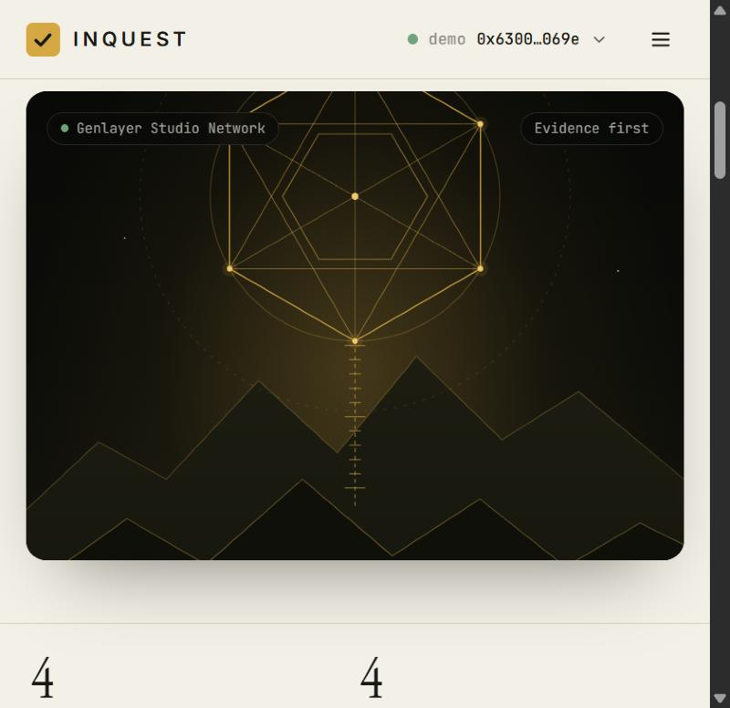
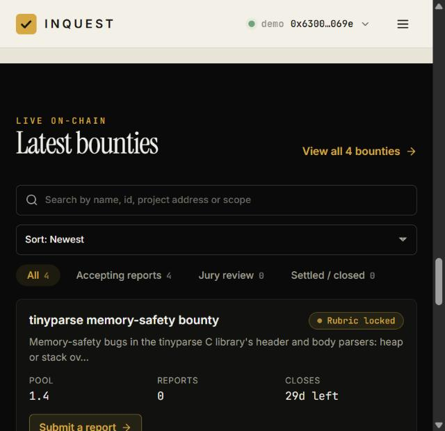
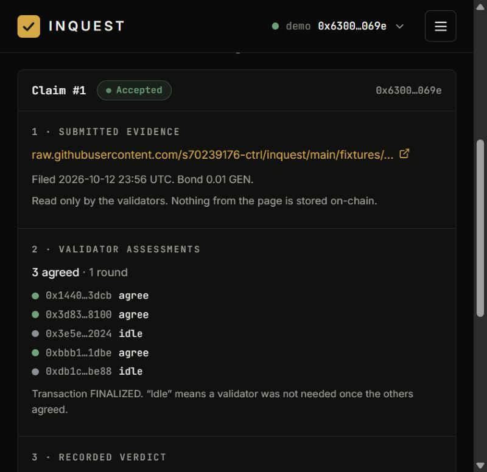

<p align="center">
  
</p>

# Inquest

**A bug isn't real until it repros.**

Inquest is a bug bounty that **settles on GenLayer**. A project locks GEN and a frozen rubric. A researcher submits one **public writeup URL** and a small bond. Each validator fetches that page itself and answers one fixed schema of five fields. A plain table then pays, slashes or refunds, and GEN moves only when the verdict finalizes. **If the jury cannot decide, the money does not move.**

There is no admin key, no moderator, no backend model and no oracle. GenLayer is the settlement layer: take it away and nobody is left to decide.

## Live

| | |
| --- | --- |
| **Live app** | https://inquest-repro.vercel.app/ |
| **Network** | GenLayer Studionet (chain id `61999`, RPC `https://studio.genlayer.com/api`) |
| **Contract** | [`0xb65Ff1E3F4DDE55fF56d3A5ee98f51aDB7944630`](https://explorer-studio.genlayer.com/address/0xb65Ff1E3F4DDE55fF56d3A5ee98f51aDB7944630) on the GenLayer Studio Explorer |
| **Deploy transaction** | [`0x6e759e8f…9935384e`](https://explorer-studio.genlayer.com/tx/0x6e759e8f45c53ce64df08ec3b20ddfb25bbe42fdbd642ba84f8da07a9935384e) |
| **Parameters** | retry gap 6 h, 3 unreachable attempts, claim expiry 14 days (constructor arguments, fixed forever) |
| **Source** | https://github.com/s70239176-ctrl/inquest |
| **Review response** | [docs/STEWARD-RESPONSE.md](docs/STEWARD-RESPONSE.md): each review point, the change, the evidence, and what is **not** demonstrated |

The hosted app talks to that contract out of the box (the address is committed in `web/.env.production`; set `VITE_CONTRACT_ADDRESS` to point a build elsewhere). No wallet is needed: **Use demo account** signs with a throwaway Studionet key. The contract page lists every transaction, including the `create_bounty`, `submit_claim` and `resolve_claim` calls behind the demo data.

Studionet is a shared test network and can be reset, so the address above is a snapshot. `node web/scripts/deploy.mjs` deploys a fresh contract, `node web/scripts/seed.mjs <address>` seeds one finalized example, and `node web/e2e/live.mjs` re-runs the full live suite against a new contract (its latest address and transaction hashes are in [docs/E2E-REPORT.md](docs/E2E-REPORT.md)).

> **Inquest does not run exploits and does not certify that software is secure.** It reads one public writeup. It never executes a proof of concept, never follows links found inside a writeup, and never sends traffic to a target. It is not legal advice, a security warranty, or permission to attack anything.

<table>
  <tr>
    <td width="25%"></td>
    <td width="25%"></td>
    <td width="25%"></td>
    <td width="25%"></td>
  </tr>
</table>

## Why this needs GenLayer

"Does this writeup actually prove an in-scope, non-duplicate bug?" is a judgment over untrusted prose. A normal contract cannot read a page, and a centralized reviewer is exactly the trusted party a bounty is trying to avoid. GenLayer lets independent validators each read the evidence and agree on a small structured answer, and lets the contract act on that answer.

The writeup is **hostile input**. It may contain text telling the model to pay. That text is evidence, never a command: it is fenced as untrusted data, and a leader that obeys it produces a different five-field object from an honest validator and is rejected. See [docs/ARCHITECTURE.md](docs/ARCHITECTURE.md).

## How it works

```
project    create_bounty(rubric, payouts, bond) + GEN pool        rubric & pool frozen
researcher submit_claim(url, evidence_hash) + bond                PENDING, committed to the page's text
anyone     resolve_claim(id)  (oldest pending claim first)        validators fetch, check the commitment,
                                                                  answer 5 fields
contract   decide(five fields)  ──►  pay / slash / refund          GEN moves only on FINALIZATION
anyone     expire_claim(id)   (after the waiting window)          bond returned, queue moves on
```

The only judgment:

```json
{ "evidence_available": false, "demonstrated": false, "in_scope": false, "duplicate_of": null, "severity": "none" }
```

| Normalized result | Pool | Bond |
| --- | --- | --- |
| Evidence unavailable (dead URL, login wall, not a writeup) | unchanged | returned |
| Not demonstrated, or out of scope | unchanged | slashed to the project |
| Duplicate of an accepted claim | unchanged | returned |
| Demonstrated, in scope, original, severity low / medium / high | pays that band (capped by the remaining pool) | returned |

Validators accept the leader **only when all five normalized fields, and the integrity check below, equal their own independently fetched result**. Prose is never compared. The judge reads only the frozen rubric, the submitted URL, and **every** earlier accepted claim on the same bounty (at most 12 are ever paid, so that is the whole history).

**Fairness rules**

- **Submission order is precedence.** Only the oldest pending claim on a bounty can be judged, so a later copy can never be adjudicated, and paid, before the original.
- **Evidence is committed.** The researcher commits to the sha256 of the page's cleaned text. A page that changed after filing is judged unsupported (bond slashed, the model is never asked). A page that is unreachable is retried a bounded number of spaced times; unreachable every time counts as withdrawn evidence (bond slashed), so a short outage is free and taking a bad report offline earns no refund.
- **Nothing can be stuck.** A claim the jury never settles can be expired by anyone after its window: the bond is returned and the queue moves on.
- **The project can't strand a waiting claim.** `withdraw` keeps a reserve for every pending claim.
- **Failed transfers are recoverable** through a per-recipient ledger.

Details and trade-offs: [docs/ARCHITECTURE.md](docs/ARCHITECTURE.md).

## The interface

*Editorial clarity outside, technical precision inside.* The homepage is an ivory publication (Instrument Serif, a gold-deep accent, a hand-drawn SVG landscape with fine gold geometry) that hands over to a near-black protocol interface where the work happens.

| Route | What it is |
| --- | --- |
| `#/` | Editorial homepage: hero, live figures, how it works, latest bounties, closing call to action |
| `#/bounties` | Searchable, filterable, sortable list (table on desktop, cards on mobile) |
| `#/b/:id` | Bounty with tabs: **Overview**, **Frozen rubric**, **Submitted writeups**, **Jury review**, **On-chain activity** (deep links: `#/b/:id/rubric`, `/writeups`, `/jury`, `/activity`) |
| `#/c/:id` | One claim: the five fields, its evidence commitment, queue position (resolve, retry wait or expire), the settlement timeline, the protocol appeal panel |
| `#/create` | Three steps (basic details, rubric and payouts, review and lock) with a confirmation dialog before the irreversible transaction |
| `#/mine` | Your submissions, bounties, rewards and bonds, and activity |

Every label maps to protocol state, never to a guess: *Rubric locked*, *Accepting reports*, *Jury review*, *Settled / closed*. **Jury review shows the real jury**: the evidence the researcher submitted, what each validator voted (read live from the node's consensus data), and the verdict the contract recorded are shown side by side as three different things. Nothing on the homepage is invented: the four figures are computed from the contract.

## Run it

```bash
# contract: lint + Direct Mode tests (no network)
pip install -r requirements.txt
genvm-lint check contracts/inquest.py
python -m pytest                                  # Windows: PYTHONPATH=scripts python -m pytest -p windows_direct_plugin

# web app
cd web && npm install
node --experimental-strip-types scripts/deploy.mjs       # deploys to Studionet, writes web/.env.local
npm run dev                                       # http://localhost:5173
npm run fingerprint -- https://example.org/my-writeup.md   # the evidence commitment for a page

# the full live suite against Studionet (real validators, real page fetches, real GEN accounting)
node --experimental-strip-types e2e/live.mjs      # ~1 hour; writes docs/E2E-REPORT.md
# payment paths reaching recipients' own balances: contract wallets on Studionet, EOAs on a testnet
node --experimental-strip-types e2e/contract-wallet.mjs
INQUEST_CHAIN=testnetBradbury PROJECT_KEY=0x.. RESEARCHER_KEY=0x.. DUP_KEY=0x.. node --experimental-strip-types e2e/wallet-delivery.mjs
```

The app signs with a browser wallet (MetaMask) or a built-in **demo account** (a throwaway Studionet key in `localStorage`), so anyone can try it without installing anything. Amounts are native GEN.

## Tests

| Layer | What | Result |
| --- | --- | --- |
| Contract lint | `genvm-lint` | passes |
| Contract, Direct Mode | `tests/direct`: settlement table, refusals and refunds, precedence in every submit order, duplicates beyond an eight-report window and at the 12-finding cap, evidence changed / unreachable / withdrawn, retry spacing, expiry after repeated undetermined consensus, withdraw reserve, failed-payment recovery, views | **116 pass** |
| Python / JS parity | 20 shared fingerprint vectors generated by the contract and asserted by both suites | pass |
| Web | typecheck, 48 unit tests (decoding, calldata, formatting, rubric, status and queue mapping, search, sort, fingerprint parity), production build | passes |
| **Live end to end** | `web/e2e/live.mjs` on Studionet, public fixtures fetched from GitHub, GEN verified through the contract balance and contract-state readbacks | **44 pass, 1 not demonstrated (EOA wallet delivery), 0 fail**: [docs/E2E-REPORT.md](docs/E2E-REPORT.md) |
| **Recipient balances** | `web/e2e/contract-wallet.mjs`: reward, bond refund, cancellation and withdrawal each land in a contract wallet's own balance | **6/6 delivered**: [docs/WALLET-DELIVERY-studionet-contract-wallets.md](docs/WALLET-DELIVERY-studionet-contract-wallets.md) |
| **Browser** | the app driven in a browser against live Studionet with the demo account: the browser fingerprints a page, files a claim, resolves it, and the verdict and payout read back | verified |

The live suite is not mocked: it deploys a fresh contract, validators fetch the fixture pages (`fixtures/tinyparse/`, a fictional C library) and run their own models, and money is checked through the contract's own balance. It covers an in-scope **high payout**, a **medium** payout (lower band for an out-of-bounds read), an **out-of-scope slash**, a **prompt-injection page** (never high, never paid), **provisional-vs-finalized money movement** (unchanged at ACCEPTED, moved at FINALIZED), a settled claim that cannot resolve twice, and the v2 rules: a **copier refused until the original is judged**, then judged a duplicate of it; a **changed page** slashed without asking the model; an **unreachable page** retried (spaced) and finally treated as withdrawn; soft refusals that refund; a **duplicate of the oldest of ten accepted reports**; **withdraw leaving a reserve** that still pays a pending claim in full; a **stuck claim that expires** and unblocks the queue; and a final **conservation** check (contract balance equals pools + slashed bonds + pending bonds + failed-payment ledger).

**Live runs repeat honestly.** Because the jury is a model, borderline pages can be judged differently between runs (the injection fixture was once judged "not evidence", bond returned, and once "not demonstrated", bond slashed; both are correct under the table and both are accepted by the check). Runs that exposed real defects were fixed and rerun in full: a refused payable call stranding the bond, markup stripping corrupting raw markdown and code, and the model omitting a null field.

**Browser run.** With the built-in demo account the UI created a 1.4 GEN bounty, a second demo account submitted the high-severity fixture, and Resolve ran the real jury: the five-field verdict card showed `demonstrated true · in_scope true · duplicate_of null · severity high`, the timeline stayed provisional until finalization, then read "Finalized: GEN moved, 1 GEN paid to the researcher, bond returned", and the appeal panel closed ("this verdict is final").

### Not exercised

- **Delivery to an externally-owned account.** Studionet does not credit EOAs from contract-emitted transfers (the live suite's `PAY` check records the balance staying at 0 after a finalized payout). The same four payment paths are shown reaching **contract wallets** (6/6), and `web/e2e/wallet-delivery.mjs` is ready to prove the EOA case on a testnet, but it has not been run because it needs funded testnet accounts.
- **The failed-payment callback on a live network.** Studionet never fires `__on_errored_message__`; recovery is tested by simulating the callback offline.
- **A protocol appeal.** Studionet cannot take one from the SDK: its chain config has no appeals contract (`canAppeal` and the charge quote are unsupported) and the node rejects `submitAppeal` ("Invalid transaction data"). The live suite records this as a skipped check with the measured errors. The contract has no `appeal` method; re-execution safety is covered by finalization-only transfers, the idempotent `resolve_claim`, and an offline snapshot/revert test. The Appeal button is untested against a network that accepts it.
- **A browser wallet** (MetaMask). The wallet path shares the same client code as the demo account but was not driven; [docs/METAMASK-CHECKLIST.md](docs/METAMASK-CHECKLIST.md) is a walkthrough for someone with a wallet.
- **Mobile layout** was checked at pane width only.

## Repository layout

```
contracts/inquest.py      the Intelligent Contract
tests/direct/             offline contract tests
web/                      Vite + React + TypeScript + genlayer-js
web/e2e/live.mjs          the live end-to-end suite
web/e2e/contract-wallet.mjs, wallet-delivery.mjs   recipient-balance proofs
web/scripts/              deploy, seed, fingerprint and debugging helpers
tests/vectors/            Python/JS fingerprint parity vectors
tests/support/            test-only contracts
SUBMISSION.md             the hackathon write-up
fixtures/tinyparse/       public writeups with known ground truth
docs/                     architecture, demo script, e2e report
```

## Design choices worth knowing

- **Money is ordinary code.** No model is ever asked about value. `decide()` is a pure function of the five normalized fields.
- **Every transfer is `emit_transfer(on="finalized")`.** A provisional result moves nothing; an appeal that overturns the round discards its messages.
- **Precedence is submission order.** `resolve_claim` refuses anything but the oldest pending claim.
- **Evidence is a commitment.** `submit_claim` takes a sha256 of the cleaned page; the same cleaner runs in Python and TypeScript, pinned by shared vectors.
- **`resolve_claim` is idempotent.** The claim flips to `RESOLVED` first, so a re-execution cannot pay twice.
- **No page text and no model prose is stored**, only the five fields, the payout, the bond outcome and the evidence fingerprint.
- **A claim that is real and in scope but below the lowest severity bar** pays nothing and returns the bond (the spec's table has no row for it).
- **Claim URLs** must be a DNS name with no port or credentials; raw IPs, `localhost`, `.local`, `.internal` are refused.
- **A raised error keeps its attached GEN in the contract** on this runtime (measured live), so the two payable methods never raise: a refused `create_bounty` / `submit_claim` returns `{ok:false, reason}` and refunds the exact value on finalization. The UI also validates and dry-runs before any value leaves the account.
- **genlayer-js 1.1.8** is pinned: the 2.0 release candidate cannot read from or deploy to the live Studionet. `web/src/lib/chain.ts` feature-detects the 2.x-only calls.
- **Appeals are the protocol's.** The contract has no `appeal` method. On Studionet the SDK cannot file one (no appeals contract, and the node rejects `submitAppeal`), so the claim page shows the window and withholds the button there; the same panel shows the charge and the button where the network supports it.

## Known limits

- Requiring all five fields to match makes long or borderline writeups likely to end **UNDETERMINED** (nothing moves, resolve again). That is the intended fail-safe; short, concrete writeups with a clear reproduction agree most often.
- Studionet only. `list_claims` scans all claims (fine at 40 claims per bounty).
- Only the first 12,000 characters of a page are committed and judged. Researchers whose browser cannot read their page (no CORS) compute the fingerprint with `npm run fingerprint`.
- A stuck oldest claim delays the claims behind it until its retries run out (default 12 h) or its window ends (default 14 days). Anyone can expire it.
- The resolve transaction id is remembered per browser; on another device paste it to check the appeal window.

## Roadmap

Per-bounty reviewer allow-lists for private disclosures, severity calibration against CVSS vectors in the rubric, claim batching, and mainnet deployment once appeals are production-ready.
