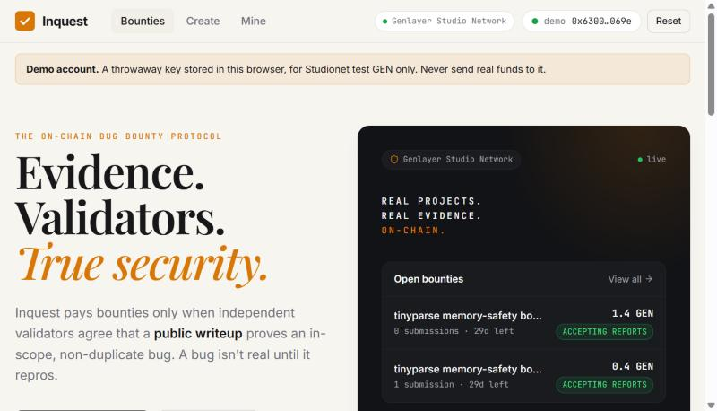
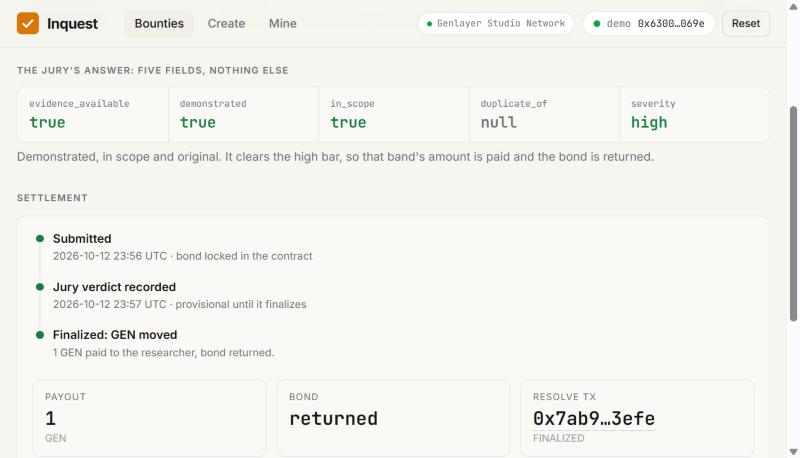

# Inquest

**A bug isn't real until it repros.**

Inquest is a bug bounty that **settles on GenLayer**. A project locks GEN and a frozen rubric. A researcher submits one **public writeup URL** and a small bond. Each validator fetches that page itself and answers one fixed schema of five fields. A plain table then pays, slashes or refunds, and GEN moves only when the verdict finalizes. **If the jury cannot decide, the money does not move.**

There is no admin key, no moderator, no backend model and no oracle. GenLayer is the settlement layer: take it away and nobody is left to decide.

> **Inquest does not run exploits and does not certify that software is secure.** It reads one public writeup. It never executes a proof of concept, never follows links found inside a writeup, and never sends traffic to a target. It is not legal advice, a security warranty, or permission to attack anything.

<p align="center">
  
</p>
<p align="center">
  
</p>

## Why this needs GenLayer

"Does this writeup actually prove an in-scope, non-duplicate bug?" is a judgment over untrusted prose. A normal contract cannot read a page, and a centralized reviewer is exactly the trusted party a bounty is trying to avoid. GenLayer lets independent validators each read the evidence and agree on a small structured answer, and lets the contract act on that answer.

The writeup is **hostile input**. It may contain text telling the model to pay. That text is evidence, never a command: it is fenced as untrusted data, and a leader that obeys it produces a different five-field object from an honest validator and is rejected. See [docs/ARCHITECTURE.md](docs/ARCHITECTURE.md).

## How it works

```
project    create_bounty(rubric, payouts, bond) + GEN pool        rubric & pool frozen
researcher submit_claim(url) + bond                               PENDING, nothing judged yet
anyone     resolve_claim(id)                                      validators fetch + answer 5 fields
contract   decide(five fields)  ──►  pay / slash / refund          GEN moves only on FINALIZATION
```

The only judgment:

```json
{ "evidence_available": false, "demonstrated": false, "in_scope": false, "duplicate_of": null, "severity": "none" }
```

| Normalized result | Pool | Bond |
| --- | --- | --- |
| Evidence unavailable (dead URL, login wall, not a writeup) | unchanged | returned |
| Not demonstrated, or out of scope | unchanged | slashed to the project |
| Duplicate of an accepted claim | unchanged | returned |
| Demonstrated, in scope, original, severity low / medium / high | pays that band (capped by the remaining pool) | returned |

Validators accept the leader **only when all five normalized fields equal their own independently fetched result**. Prose is never compared. The judge reads only the frozen rubric, the submitted URL, and up to 8 earlier accepted claim URLs on the same bounty.

## Run it

```bash
# contract: lint + Direct Mode tests (no network)
pip install -r requirements.txt
genvm-lint check contracts/inquest.py
python -m pytest                                  # Windows: PYTHONPATH=scripts python -m pytest -p windows_direct_plugin

# web app
cd web && npm install
node scripts/deploy.mjs                           # deploys to Studionet, writes web/.env.local
npm run dev                                       # http://localhost:5173

# the full live suite against Studionet (real validators, real page fetches, real GEN accounting)
node e2e/live.mjs                                 # writes docs/E2E-REPORT.md
```

The app signs with a browser wallet (MetaMask) or a built-in **demo account** (a throwaway Studionet key in `localStorage`), so anyone can try it without installing anything. Amounts are native GEN.

## Tests

| Layer | What | Result |
| --- | --- | --- |
| Contract lint | `genvm-lint` | passes |
| Contract, Direct Mode | `tests/direct`: spec cases 1-14, refusals and refunds, page-text handling, views | **108 pass** |
| Web | typecheck, 13 unit tests (decoding, calldata, formatting, rubric), production build | passes |
| **Live end to end** | `web/e2e/live.mjs` on Studionet, public fixtures fetched from GitHub, GEN verified through the contract balance | **44 pass, 1 skipped (platform), 0 fail**: [docs/E2E-REPORT.md](docs/E2E-REPORT.md) |
| **Browser** | the app driven in a browser against live Studionet with the demo account: create, submit, resolve, finalized settlement | verified (see below) |

The live suite is not mocked: it deploys a fresh contract, validators fetch the fixture pages (`fixtures/tinyparse/`, a fictional C library) and run their own models, and money is checked through the contract's own balance. It covers an in-scope **high payout**, a **medium** payout (lower band for an out-of-bounds read), an **out-of-scope slash**, a **duplicate that calls itself novel**, a **prompt-injection page** (never high, never paid), a **dead URL**, submit-rule refusals **with refunds**, the pool/economy limits and depletion, **cancel**, **deadline** and **withdraw** rules, **provisional-vs-finalized money movement** (unchanged at ACCEPTED, moved at FINALIZED), a settled claim that cannot resolve twice, and a final **conservation** check (contract balance equals pools + slashed bonds + pending bonds).

**Live runs repeat honestly.** Because the jury is a model, borderline pages can be judged differently between runs (the injection fixture was once judged "not evidence", bond returned, and once "not demonstrated", bond slashed; both are correct under the table and both are accepted by the check). Runs that exposed real defects were fixed and rerun in full: a refused payable call stranding the bond, markup stripping corrupting raw markdown and code, and the model omitting a null field.

**Browser run.** With the built-in demo account the UI created a 1.4 GEN bounty, a second demo account submitted the high-severity fixture, and Resolve ran the real jury: the five-field verdict card showed `demonstrated true · in_scope true · duplicate_of null · severity high`, the timeline stayed provisional until finalization, then read "Finalized: GEN moved, 1 GEN paid to the researcher, bond returned", and the appeal panel closed ("this verdict is final").

### Not exercised

- **A protocol appeal.** Studionet cannot take one from the SDK: its chain config has no appeals contract (`canAppeal` and the charge quote are unsupported) and the node rejects `submitAppeal` ("Invalid transaction data"). The live suite records this as a skipped check with the measured errors. The contract has no `appeal` method; re-execution safety is covered by finalization-only transfers, the idempotent `resolve_claim`, and an offline snapshot/revert test. The Appeal button is untested against a network that accepts it.
- **A browser wallet** (MetaMask). The wallet path shares the same client code as the demo account but was not driven.
- **Mobile layout** was checked at pane width only.

## Repository layout

```
contracts/inquest.py      the Intelligent Contract
tests/direct/             offline contract tests
web/                      Vite + React + TypeScript + genlayer-js
web/e2e/live.mjs          the live end-to-end suite
web/scripts/              deploy, smoke and debugging helpers
SUBMISSION.md             the hackathon write-up
fixtures/tinyparse/       public writeups with known ground truth
docs/                     architecture, demo script, e2e report
```

## Design choices worth knowing

- **Money is ordinary code.** No model is ever asked about value. `decide()` is a pure function of the five normalized fields.
- **Every transfer is `emit_transfer(on="finalized")`.** A provisional result moves nothing; an appeal that overturns the round discards its messages.
- **`resolve_claim` is idempotent.** The claim flips to `RESOLVED` first, so a re-execution cannot pay twice.
- **No page text and no model prose is stored**, only the five fields, the payout and the bond outcome.
- **A claim that is real and in scope but below the lowest severity bar** pays nothing and returns the bond (the spec's table has no row for it).
- **Claim URLs** must be a DNS name with no port or credentials; raw IPs, `localhost`, `.local`, `.internal` are refused.
- **A raised error keeps its attached GEN in the contract** on this runtime (measured live), so the two payable methods never raise: a refused `create_bounty` / `submit_claim` returns `{ok:false, reason}` and refunds the exact value on finalization. The UI also validates and dry-runs before any value leaves the account.
- **genlayer-js 1.1.8** is pinned: the 2.0 release candidate cannot read from or deploy to the live Studionet. `web/src/lib/chain.ts` feature-detects the 2.x-only calls.
- **Appeals are the protocol's.** The contract has no `appeal` method. On Studionet the SDK cannot file one (no appeals contract, and the node rejects `submitAppeal`), so the claim page shows the window and withholds the button there; the same panel shows the charge and the button where the network supports it.

## Known limits

- Requiring all five fields to match makes long or borderline writeups likely to end **UNDETERMINED** (nothing moves, resolve again). That is the intended fail-safe; short, concrete writeups with a clear reproduction agree most often.
- Studionet only. `list_claims` scans all claims (fine at 40 claims per bounty).
- The resolve transaction id is remembered per browser; on another device paste it to check the appeal window.

## Roadmap

Per-bounty reviewer allow-lists for private disclosures, severity calibration against CVSS vectors in the rubric, claim batching, and mainnet deployment once appeals are production-ready.
